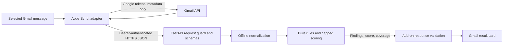

# Upwind Mail Guard

Upwind Mail Guard is a Gmail add-on that explains warning signs in the selected email. An explicit
**Analyze this email** action sends bounded message fields to a separate Python/FastAPI backend,
which returns a **0–100 heuristic risk score**, a verdict, evidence, and the checks it could complete.
The Gmail card shows the strongest reasons first, with expandable evidence and score calculations.

The solution is implemented, hosted on Northflank, and demonstrated in a real Gmail account.
**A low score does not establish safety, and the score is not a probability.** Missing information,
truncation, and backend failures are shown explicitly.

## Quick-start video

[**Watch the 61-second Gmail walkthrough (MP4)**](docs/assets/quick-start.mp4)

A captioned recording of the installed add-on: analyze a selected email, read the score, expand
supporting evidence and coverage details, then compare a benign message. It uses synthetic emails
and the hosted backend. The recording is cropped and edited for privacy and readability; no audio
is required. For installation, follow [the setup instructions below](#3-install-your-own-gmail-add-on).

## Start here

| Reviewer goal | What to do | Access required |
| --- | --- | --- |
| Check the submitted backend is online | [Check hosted health](#1-hosted-submission) | None; this does not run email analysis |
| Run the implementation and automated checks | [Reproduce locally (optional)](#2-reproduce-and-test-locally-optional), including an authenticated API example | Python 3.12, Node.js 22+, and your own generated token; no Google account needed |
| Try the complete Gmail experience | [Install your own test add-on](#3-install-your-own-gmail-add-on) | A Google account, an Apps Script project, and an HTTPS backend using your own token |
| Assess the engineering choices | Read [scoring](#detection-and-scoring), [architecture](#architecture), and [decisions](#design-decisions-and-tradeoffs) | Source and synthetic fixtures are included |

The submitted Apps Script deployment is an account-installed **test deployment**, not a published
Marketplace app. Cloning this repository does not install it in your Gmail account. The hosted
analysis API requires a private demo token that is intentionally absent from Git; independent
review does not require it. Follow the local/Gmail paths below to use your own backend and token.

## 1. Hosted submission

Backend origin: `https://p01--upwind-mail-guard--vpdljyyj7txr.code.run`

```bash
curl --fail --silent --show-error \
  https://p01--upwind-mail-guard--vpdljyyj7txr.code.run/healthz
```

Expected: `{"status":"ok"}`. This checks availability, not authentication or detection quality.
The analysis routes reject requests without a valid bearer token with HTTP 401.

The deployment uses the repository's Dockerfile, one 0.1 CPU / 256 MB Northflank Developer Sandbox
instance in London, and an HTTP `/healthz` readiness probe. Gmail was verified with the local backend
stopped; the submitted service does not depend on the development laptop. Free hosting provides no
uptime guarantee. Exact deployment settings are in [deployment.md](docs/deployment.md).

## 2. Reproduce and test locally (optional)

The submitted backend is already hosted; local setup is an optional way to reproduce the code
and run tests with your own token. It is not required to keep the submitted service online.

The commands below use a macOS/Linux shell. Install **Python 3.12**, **Node.js 22 or newer**, and Git.
Initial dependency installation requires internet access; message analysis does not call external
reputation, inference, DNS, or URL-fetching services.

```bash
git clone https://github.com/ShaharMaaravi/upwind-mail-guard.git
cd upwind-mail-guard
python3.12 -m venv .venv
source .venv/bin/activate
python -m pip install -r backend/requirements-dev.txt
pytest -q
ruff check backend scripts/container-smoke.py
ruff format --check backend scripts/container-smoke.py
npm test
npm run test:integration
```

Expected: **248 Python tests**, **90 Node tests**, passing lint/format checks, and `PASS` messages
from the integration script. No npm packages need installing: JavaScript tests use Node's built-in
runner. The integration script creates its own temporary token, starts/stops a real loopback backend,
and exercises the actual add-on JavaScript. **Google services are mocked in that test**; it does not
install the add-on or verify Gmail permissions.

### Start your backend

From the repository root with `.venv` active, generate a random secret in an ignored file:

```bash
python - <<'PY'
import os, secrets
fd = os.open('.env', os.O_WRONLY | os.O_CREAT | os.O_EXCL, 0o600)
with os.fdopen(fd, 'w') as f:
    f.write('MAIL_GUARD_API_TOKEN=' + secrets.token_urlsafe(32) + '\n')
PY
set -a
source .env
set +a
python -m uvicorn app.main:create_app --factory --app-dir backend \
  --host 127.0.0.1 --port 8000 --no-access-log \
  --limit-concurrency 32 --timeout-keep-alive 5
```

Leave this terminal running. If `.env` already exists, skip generation and reuse it; the command
refuses to overwrite it. Startup fails when the token is absent or malformed. Never commit the
secret or put it in a URL. The same token will later go into your Google Script Properties.

### Analyze a synthetic fixture

In a second terminal, enter the same repository directory and activate `.venv`. Run:

```bash
source .venv/bin/activate
python - <<'PY'
import json
from pathlib import Path
from urllib.request import Request, urlopen

token = next(line.partition('=')[2].strip() for line in Path('.env').read_text().splitlines()
             if line.startswith('MAIL_GUARD_API_TOKEN='))
request = Request(
    'http://127.0.0.1:8000/v1/analyze',
    data=Path('fixtures/analysis-request.json').read_bytes(),
    headers={'Authorization': 'Bearer ' + token, 'Content-Type': 'application/json'},
)
with urlopen(request, timeout=10) as response:
    result = json.load(response)
print(json.dumps({key: result[key] for key in ('score', 'verdict', 'analysis_status')}, indent=2))
PY
```

Expected: `score: 95`, `verdict: "high_risk"`, `analysis_status: "partial"`.
This fixture combines a displayed/destination URL mismatch, Reply-To mismatch, and executable
filename metadata. Its authentication field is unavailable, so coverage remains partial even
though all eight rules run. The token is read from the file, not exposed in command-line arguments.

`POST /v1/analyze` accepts bounded message fields, optional attachment metadata, truncation flags,
a schema version, and a random request reference. It returns findings, score accounting, verdict,
and coverage. `POST /v1/diagnose` is a transport diagnostic returning field counts without a score.
See the included [request fixture](fixtures/analysis-request.json) and
[complete API contract](docs/analysis-contract.md).

**Optional Docker check:** with Docker running, execute `docker build -t upwind-mail-guard:local .`
and `python scripts/container-smoke.py upwind-mail-guard:local`. The smoke script uses disposable
containers and its own token, then cleans them up. Manual container hosting commands are in
[deployment.md](docs/deployment.md).

## 3. Install your own Gmail add-on

Use your own demonstration Google account and synthetic emails. Workspace administrators may
restrict test add-ons or authorization. Apps Script runs on Google and cannot reach `localhost`.

1. **Expose your backend over HTTPS.** With the local server still running, install
   [Cloudflare's cloudflared](https://developers.cloudflare.com/cloudflare-one/connections/connect-networks/downloads/)
   and run `cloudflared tunnel --url http://127.0.0.1:8000` in another terminal. Keep both processes
   running and copy the printed HTTPS origin. Alternatively, deploy the root Dockerfile to your
   chosen host with port 8080, `/healthz`, and `MAIL_GUARD_API_TOKEN` in its runtime environment.
2. **Build for your origin.** From the repository root, run the command below, substituting the
   actual HTTPS origin with no path, credentials, query, or explicit port:

   ```bash
   npm run build:addon -- https://YOUR-PUBLIC-BACKEND-HOST
   ```

3. **Create the Google project.** Open [Apps Script](https://script.google.com/), create a standalone
   project named **Upwind Mail Guard**, and enable **Project Settings → Show appsscript.json manifest
   file in editor**. Replace that manifest with `addon/build/appsscript.json`.
4. **Upload the generated code.** Create six script files named `Deployment`, `Extraction`,
   `Validation`, `ApiClient`, `Cards`, and `Handlers`. Paste each matching file from `addon/build/`
   into it; Google displays them as `.gs` files. Remove the unused default empty function.
5. **Set credentials and service.** In **Project Settings → Script Properties**, set
   `MAIL_GUARD_API_TOKEN` to the value from your `.env`, without the name or equals sign. Confirm
   **Services** contains **Gmail API v1**, declared by the generated manifest. If missing, add it
   and review Google's terms. A standard Google Cloud project also needs Gmail API enabled there.
6. **Install.** Save, choose **Deploy → Test deployments → Google Workspace Add-on → Install**,
   then refresh Gmail. Open **Upwind Mail Guard** from the sidebar and authorize its requested
   current-message and external-request permissions in your account.
7. **Analyze.** Open a synthetic email, expand the intended message header if it is part of a
   conversation, and choose **Analyze this email**. Check the subject/text preview, verdict, and
   coverage. Expand **Why this score** for evidence and **Checks and limitations** for details.

The build pins the same HTTPS origin in the code and fetch allowlist; it contains no secrets.
Rebuild and upload both code and manifest whenever the origin changes. Google tokens and message
IDs stay on Google requests; the backend receives only the bounded analysis payload.

**If setup fails:** check `/healthz`, matching tokens, the built origin/allowlist, Gmail API
activation, and Google authorization. Authentication failures show **Analysis unavailable**, not
zero risk. After a Google execution timeout, return to the message list and reopen the email.
Detailed scope notes and optional `clasp` synchronization are in [Gmail setup](docs/gmail-setup.md).

## Detection and scoring

Eight deterministic rules produce evidence and provisional point contributions:

| Signal | Requested points | Example or limitation |
| --- | ---: | --- |
| Displayed URL and destination identify different sites | 40 | Legitimate tracking links can also trigger this |
| URL contains user-info before `@` | 25 | Can disguise the actual destination host |
| URL host is a literal IP address | 15 | An IP address alone does not establish malicious intent |
| From and Reply-To use different registrable domains | 15 | Support and mailing services can differ legitimately |
| Credential request with nearby pressure | 25 | Narrow English patterns, not semantic understanding |
| Payment request with nearby pressure | 25 | Ordinary urgent invoices can trigger this |
| Executable/script/installer/shortcut filename | 35 | Filename metadata only; contents are not inspected |
| Misleading double extension | 20 | For example, `invoice.pdf.exe` |

Repeated evidence is deduplicated. Category caps are **URL 60, sender 20, content 35, attachments 40**;
the total is capped at **100**. Deterministic ordering makes results reproducible. Each finding
records requested, awarded, and suppressed points, so the displayed total can be reconciled.
Weights and thresholds are design choices, not learned or calibrated probabilities.

| Result | Meaning |
| --- | --- |
| 0–24, complete | Low observed risk: few implemented warning signs |
| 25–59 | Suspicious |
| 60–100 | High risk |
| Below 25, partial | Inconclusive: missing coverage prevents a reassuring verdict |
| No evaluable checks or a failed request | Analysis unavailable; no numeric safety score |

**Risk and coverage are separate.** A high score can coexist with partial analysis. “Complete”
means the implemented checks ran on the supplied fields; it does not mean every threat was checked
or sender authentication was verified.

### Worked Gmail example: 75 / high risk

The live synthetic email requested a password and urgent invoice payment, included
`https://example.com@192.0.2.1/review` (inert example; do not visit), and had a harmless `.txt` attachment.

| Finding | Requested | Awarded |
| --- | ---: | ---: |
| Urgent credential request | 25 | 25 |
| Urgent payment request | 25 | 10 — content category cap reached |
| URL user-info | 25 | 25 |
| Literal IP destination | 15 | 15 |
| **Total** | **90** | **75** |

All eight rules ran; the text attachment contributed no finding. Repeated plain-text/HTML signals
were deduplicated. Gmail displayed **High risk**, advised avoiding links/attachments and verifying
the request independently, and showed three leading reasons with all four findings expandable.
This example is distinct from the **95-point API fixture** above. The benign live message scored
**0**; a long reply scored **25 / partial** with body truncation visible. See [demo.md](docs/demo.md)
for the full walkthrough.

## Architecture



The adapter bounds extraction and handles Google's selected-message context. The backend
normalizes evidence, evaluates rules, and computes the score independently of Gmail or HTTP.
The add-on validates the response's version, request reference, coverage, and arithmetic before
rendering escaped text. No email history or message IDs are stored between analyses.

| Location | Responsibility |
| --- | --- |
| `addon/src/` | Extraction, API client, response validation, cards, and Google callbacks |
| `backend/app/main.py`, `security.py`, `config.py` | HTTP routes, authentication, limits, and startup configuration |
| `backend/app/analysis_schemas.py`, `schemas.py` | Strict analysis and diagnostic contracts |
| `backend/app/normalization.py`, `domains.py` | Inert parsing, URL/address normalization, offline domain boundaries |
| `backend/app/rules.py`, `scoring.py`, `analysis.py` | Detection, policy/accounting, and orchestration |
| `addon/tests/`, `backend/tests/`, `fixtures/` | Tests and synthetic examples, including known false positives |
| `scripts/`, `.github/workflows/ci.yml` | Build, HTTP/container checks, and CI |

## Design decisions and tradeoffs

| Choice | Why it fits this submission | Cost and alternative |
| --- | --- | --- |
| Apps Script + CardService | Native Gmail UI and current-message access with little infrastructure | Restricted layout and execution time; an HTTP-based Workspace add-on runtime offers different hosting control with more setup |
| Python/FastAPI + strict Pydantic schemas | Readable analysis modules and explicit validation at the API boundary | Two languages to maintain; Node/TypeScript could unify the stack |
| Deterministic rules with capped scores | Explainable, repeatable, inexpensive, and testable without external inference | Limited semantic coverage and provisional weights; an evaluated classifier/LLM could broaden coverage but adds privacy, latency, cost, and evaluation work |
| Stateless synchronous service, no database | Small deployment and no application email retention | No history or cross-message baseline; storage/queues would be justified for those needs or slower analysis |
| Offline domain parsing; no URL fetching or attachment execution | Predictable analysis and a smaller attack surface | Misses redirect destinations and malicious file contents; deeper inspection needs isolated workers and controlled egress |
| Random shared token for the demo | Simple authenticated communication without forwarding Google credentials | Script editors share access; broader distribution requires per-user identity/authorization and stronger abuse controls |
| Managed container, one instance | Reproducible hosting independent of the laptop | Free-tier availability and resource limits; multiple instances require a shared rate limiter |

An explicit Analyze action gives the user control over transmission. The strict response validator
adds some duplicated contract logic, but prevents a malformed backend response from becoming a
misleading card. Detailed decisions and alternatives are in [decisions.md](docs/decisions.md).

## Security boundaries and known limitations

- **Data minimization:** bounded sender, Reply-To, subject, plain text, HTML, authentication-header
  text, and attachment names/types/sizes are sent after the click. No mailbox-wide scope, recipient
  list, Google token, message ID, or attachment content enters the backend payload.
- **Untrusted inputs:** HTML is parsed without rendering or executing it; extracted URLs are never
  visited. Evidence is escaped. Authentication occurs before JSON parsing; the streaming request
  ceiling is 256 KiB with a five-second body deadline. Unexpected errors suppress content-bearing
  exception text. Application access/content logging is disabled; provider logging is a separate boundary.
- **Coverage limits:** bodies are bounded to 16,000 UTF-16 code units each during extraction, with
  further normalization limits; at most 100 raw link candidates and 20 attachment records are
  considered. Bounded MIME retrieval can omit deep/large trees. Truncation, invalid input, and skipped
  checks remain visible. Gmail retrieves body content before truncation, so this does not bound all
  Google-side work on arbitrarily large mail.
- **Detection gaps:** English patterns miss other languages and nuanced intent. Quoted scams,
  legitimate tracking links, and urgent invoices can produce false positives. HTML visibility/CSS,
  quoted-content boundaries, redirects, and attachment bytes are not evaluated. IDNs are normalized,
  not automatically considered malicious. The pinned domain suffix snapshot requires maintenance.
- **Authentication claims:** `Authentication-Results` is untrusted text. SPF, DKIM, and DMARC are
  not verified and do not alter the score. Available header text does not establish trusted provenance.
- **Demo authentication and availability:** the shared secret is accessible to script editors.
  The 30-authenticated-requests/minute limiter is per process and resets on restart; public traffic
  needs hosting-level protection at scale. Google can terminate a synchronous callback before an
  error card renders. Neither free hosting nor a passing health check guarantees an analysis deadline.

These boundaries, parser details, and remaining risks are documented in the
[security review](docs/security-review.md) and [rule specification](docs/detection-rules.md).

## Verification

Recorded on **2026-11-17**:

| Layer | Evidence | What it does not prove |
| --- | --- | --- |
| Automated tests | 248 Python + 90 Node tests; lint/format; both [release CI jobs passed](https://github.com/ShaharMaaravi/upwind-mail-guard/actions/runs/43981480994) | Production detection accuracy |
| Local HTTP integration | Actual add-on action and all 20 corpus responses validated/rendered against a real backend | Google services are mocked |
| Containers | Linux ARM64/AMD64 builds; non-root/read-only execution; auth, fixtures, log markers, missing-secret startup failure | Long-term hosting reliability |
| Hosted HTTPS | Health, unauthorized 401, fixture 95, 20 corpus scores, malformed 422, oversized 413 | Sustained load; the slowest corpus response was 0.44 s in one run |
| Real Gmail | Benign 0, suspicious 75, long reply 25/partial against hosting with the local backend stopped; metadata, escaped text, and message selection | Arbitrary mailbox/message-size coverage |
| Earlier local fault tests through Gmail | Backend outage, wrong token, Google's execution timeout, and recovery | Hosted outage behavior was not separately fault-injected |

The 20-case synthetic corpus includes benign, suspicious, incomplete, and known false-positive
cases; expected outcomes are regression evidence, not a representative accuracy benchmark.
A dated dependency audit found no known vulnerabilities in the pinned packages, not an exhaustive
security guarantee. See [live verification](docs/live-verification.md) and
[security review](docs/security-review.md) for the executed checks and limits.

For deeper review: [API/scoring contract](docs/analysis-contract.md),
[detection rules](docs/detection-rules.md), [deployment](docs/deployment.md),
and [decision record](docs/decisions.md). Development history is retained in
[progress.md](docs/progress.md); the [original plan](docs/implementation-plan.md) is archived.
