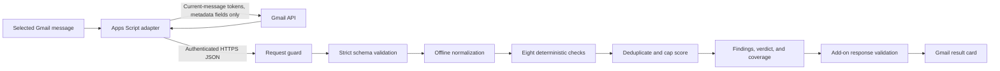

# Upwind Mail Guard

A Gmail add-on with a separate Python backend, being built for the Upwind Security Analyst assignment.

**Current status: milestone 3 Gmail analysis implemented and live-verified.**
Open an email and choose **Analyze this email** to see an explainable 0–100 heuristic score,
verdict, evidence, point contributions, and coverage for eight deterministic checks. Benign and
suspicious synthetic emails, message switching, and backend outage/recovery passed in Gmail.
Final submission hardening and packaging remain. The score is not a calibrated probability or
a guarantee of safety.

## What works now

- A contextual Gmail card with an explicit **Analyze this email** action and transmission notice.
- Bounded extraction of sender, Reply-To, subject, plain text, HTML, an authentication header,
  and metadata for up to 20 named MIME parts; no attachment contents are downloaded.
- Strictly validated analysis responses, escaped evidence, exact score accounting, and clear
  complete/partial/unavailable states. Missing data never becomes a safe verdict.
- Automated backend, add-on, build, and local HTTP integration tests.
- Strict analysis input/output models, address/HTML/URL normalization, and offline domain boundaries.
- Pure scoring with stable findings, deduplication, category caps, and exact contribution accounting.
- Eight checks for URL display mismatches, URL user-info/IP hosts, Reply-To mismatches, credential/
  payment requests with pressure, and executable/double-extension attachment filenames.
- Explicit completed/skipped checks; missing or truncated coverage cannot produce a complete result.

In a personal Gmail account through a temporary HTTPS tunnel, the benign fixture scored **0**
(low observed risk) and the suspicious fixture **75** (high risk), both with all eight checks run.
Unavailable metadata produced an explicitly partial result before Gmail API was enabled.
Broader live edge cases remain listed in the [verification record](docs/live-verification.md).
Durable hosting is not configured. The container definition is included but has not been built
locally because Docker's daemon was unavailable.

## Quick start

Requires Python 3.12 and Node.js 22 or newer. Run from the repository root:

```bash
python3 -m venv .venv
source .venv/bin/activate
python -m pip install -r backend/requirements-dev.txt
pytest -q
ruff check backend
ruff format --check backend
npm test
npm run test:integration
```

The integration command starts and stops a real loopback HTTP server and runs the add-on code
against it with synthetic data. Google services remain mocked. No Google credentials are needed.
JavaScript tests use Node's built-in test runner; no npm packages are required.

Generate a local secret without putting it in source code or command-line arguments:

```bash
python - <<'PY'
import os, secrets
fd = os.open('.env', os.O_WRONLY | os.O_CREAT | os.O_EXCL, 0o600)
with os.fdopen(fd, 'w') as f:
    f.write('MAIL_GUARD_API_TOKEN=' + secrets.token_urlsafe(32) + '\n')
PY
set -a
source .env
set +a
python -m uvicorn app.main:create_app --factory --app-dir backend \
  --host 127.0.0.1 --port 8000 --no-access-log \
  --limit-concurrency 32 --timeout-keep-alive 5
```

The secret-generation command refuses to overwrite an existing `.env`. Reuse your existing token
if already configured. `GET /healthz` returns `{"status":"ok"}`. Startup fails if the token is absent
or has an invalid format. The token must be generated randomly; a valid length alone is not entropy.

For Google setup, an HTTPS backend, and the exact files to upload, follow
[Gmail installation](docs/gmail-setup.md). A public Git repository does not install the add-on in Gmail.

## Architecture



| Location | Responsibility |
| --- | --- |
| `addon/src/Extraction.js` | Selected-message access, metadata-only MIME request, field limits |
| `addon/src/ApiClient.js` | Authenticated request, byte limits, redirects disabled |
| `addon/src/Validation.js` | Response version/correlation, coverage, verdict, and score reconciliation |
| `addon/src/Cards.js` | Analysis, escaped evidence, coverage, transmission notice, and errors |
| `addon/src/Handlers.js` | Gmail contextual and action callbacks |
| `backend/app/security.py` | Authentication, streaming byte limit, upload deadline, rate limit |
| `backend/app/schemas.py` | Versioned diagnostic request/response contract |
| `backend/app/analysis_schemas.py` | Analysis input, findings, score accounting, and coverage contract |
| `backend/app/normalization.py` | Bounded address, text, HTML, URL, and metadata normalization |
| `backend/app/domains.py` | IDNA and pinned offline Public Suffix List boundaries |
| `backend/app/rules.py` | Eight pure detection checks, evidence, and skip reasons |
| `backend/app/scoring.py` | Provisional weights, deduplication, caps, and contribution accounting |
| `backend/app/analysis.py` | Normalize → detect → score; determine coverage and verdict |
| `backend/app/main.py` | Health, diagnostic, and analysis routes |
| `scripts/` | Reproducible add-on build and local integration check |

`POST /v1/diagnose` takes a schema version, random request reference, bounded message fields,
and truncation flags. See [the synthetic request](fixtures/diagnostic-request.json).
The response contains counts only; it never echoes email content. `null` means unavailable,
while zero characters means available but empty. The diagnostic response has no score field.

`POST /v1/analyze` adds optional bounded attachment metadata and returns findings, score, completed/
skipped checks, and coverage. With no evaluable checks it returns an unavailable result and null
score. A partial result below 25 is inconclusive; positive warnings remain visible with missing data.
See the [analysis contract and scoring policy](docs/analysis-contract.md) and
[detection behavior and fixtures](docs/detection-rules.md). The [synthetic request](fixtures/analysis-request.json)
scores 95: displayed URL mismatch 40, executable filename 35, double extension 5 after its category
cap, and Reply-To mismatch 15. Authentication is unavailable/unverified, so coverage is partial.
Gmail uses this endpoint. Both endpoints share authentication, request limits, and rate limits;
the diagnostic route remains available for transport checks.

## Security boundaries and limitations

- Gmail tokens and message IDs are used only between Apps Script and Google; they are never sent
  to the backend. No mailbox-wide scope is requested.
- The backend token lives in Script Properties and the backend environment. Script editors can
  access it; this is single-demo authentication, not multi-user authorization.
- The build pins the same HTTPS backend origin in the client and manifest allowlist; the only
  additional fetch prefix is Gmail's selected-message API. Redirects are disabled and TLS
  verification stays enabled. Gmail API v1 must be enabled in the Apps Script project.
- The API authenticates before reading JSON, limits the request to 256 KiB even without a
  trustworthy Content-Length, and allows five seconds to receive a body.
- The single-instance limiter allows 30 authenticated requests/minute. It resets on restart and
  does not coordinate between instances. Public health and unauthorized traffic need hosting-level
  protection at production scale.
- No database, email-content logging, URL fetching, remote image loading, or attachment inspection.
  Authentication headers are untrusted text; SPF/DKIM/DMARC are not verified.
- Domain normalization uses the dependency's pinned PSL snapshot, including private suffixes.
  It does not download data or resolve DNS during a scan. Unknown suffixes remain coverage gaps.
- HTML parsing does not reproduce browser rendering, CSS visibility, quoted-message boundaries,
  or every browser URL interpretation. Only HTTP(S) link targets are normalized; at most 100 raw
  candidates are considered, even if they repeat. These limits can omit important evidence.
- Content rules match narrow English patterns with nearby pressure and simple negation handling.
  They do not infer intent or understand other languages. Legitimate tracking redirects, quoted
  scams, and ordinary urgent invoices can trigger warnings; the fixture suite records these cases.
- Attachment screening uses names only; declared MIME types are not proof of file type. It does
  not detect malware, inspect archives, or validate contents. Unknown file types receive no finding.
- Gmail body getters retrieve content before local truncation. The backend limit does not bound
  Google's extraction cost; test large messages live. Attachments are deliberately not downloaded.
- Metadata retrieval is bounded to 128 KiB, four MIME nesting levels below the root, and 200 nodes.
  Named MIME parts count as attachment records, including named inline parts. Deeper/extra parts
  and shortened metadata are reported as truncated; failed retrieval remains unavailable.
- The client rejects analysis responses above 512 KiB or with inconsistent accounting/coverage.
  The card shows the strongest eight findings, with omitted counts/points and full score totals.
- Apps Script's synchronous URL fetch has no configurable per-call timeout. A platform execution
  deadline may terminate the callback before it can render our error card. Backend outages and
  cold starts must therefore be tested in Gmail, not inferred from mocks.
- Deployment infrastructure can introduce logging; inspect its settings before testing real mail.
  Use synthetic emails for the integration test.

## Tests and delivery

The suite exercises authentication, malformed/oversized/chunked requests, slow uploads, disconnects,
strict input types, redacted errors, Unicode, partial extraction, forged authentication claims,
backend redirects/errors, response correlation, escaped card text, and deployment URL validation.
It also covers PSL wildcard/exception/private boundaries, Unicode domains, deceptive user-info,
IPv4/IPv6 URLs, inert HTML, bounded repeated links, score reconciliation, and unavailable analysis.
Milestone 3 passed 243 Python tests, 84 Node tests, lint/format checks, and real local HTTP integration.
The HTTP check runs the actual add-on analysis action and validates/renders all 20 corpus responses;
Google services are mocked there. Separate live Gmail checks are recorded in the verification record.
The 20-case detection corpus includes benign, suspicious, incomplete, and known false-positive cases;
matching their expected behavior is not a production accuracy estimate.
CI targets Python 3.12 / Node 22. Milestones 0–2 passed remote CI; milestone 3 awaits commit approval.

Read [progress](docs/progress.md) for executed checks and outstanding gates,
[decisions](docs/decisions.md) for tradeoffs, and the [implementation plan](docs/implementation-plan.md)
for the original sequence. Each milestone is committed only with the author's approval.
