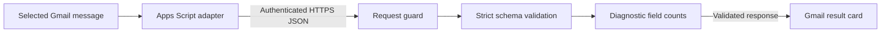

# Upwind Mail Guard

A Gmail add-on with a separate Python backend, being built for the Upwind Security Analyst assignment.

**Current status: milestone 0 scaffold implemented, with automated tests and a live Gmail connection verified.**
This version tests the selected-message-to-backend connection. It does **not** detect malicious email,
calculate a risk score, or give a safety verdict. It is not the final assignment submission.

## What works now

- A contextual Gmail card with an explicit **Test connection** action.
- Bounded extraction of sender, Reply-To, subject, plain text, HTML, and an authentication header.
- An authenticated diagnostic API returning character counts, truncation, and missing-field information.
- Clear diagnostic and failure cards; missing data never becomes a safe verdict.
- Automated backend, add-on, build, and local HTTP integration tests.

The basic flow has also been verified in a personal Gmail account through a temporary HTTPS tunnel:
authorized selected-message extraction, diagnostic rendering, backend outage, and recovery.
Broader live edge cases remain listed in the [verification record](docs/live-verification.md).
Durable hosting is not configured. The container definition is included but has not been built
locally because Docker's daemon was unavailable.

## Quick start

Requires Python 3.12 and Node.js 22 or newer. Run from the repository root:

```bash
python3 -m venv .venv
source .venv/bin/activate
python -m pip install -r backend/requirements-dev.txt
pytest -q
ruff check backend
ruff format --check backend
npm test
npm run test:integration
```

The integration command starts and stops a real loopback HTTP server and runs the add-on code
against it with synthetic data. Google services remain mocked. No Google credentials are needed.
JavaScript tests use Node's built-in test runner; no npm packages are required.

Generate a local secret without putting it in source code or command-line arguments:

```bash
python - <<'PY'
import os, secrets
fd = os.open('.env', os.O_WRONLY | os.O_CREAT | os.O_EXCL, 0o600)
with os.fdopen(fd, 'w') as f:
    f.write('MAIL_GUARD_API_TOKEN=' + secrets.token_urlsafe(32) + '\n')
PY
set -a
source .env
set +a
python -m uvicorn app.main:create_app --factory --app-dir backend \
  --host 127.0.0.1 --port 8000 --no-access-log \
  --limit-concurrency 32 --timeout-keep-alive 5
```

The secret-generation command refuses to overwrite an existing `.env`. Reuse your existing token
if already configured. `GET /healthz` returns `{"status":"ok"}`. Startup fails if the token is absent
or has an invalid format. The token must be generated randomly; a valid length alone is not entropy.

For Google setup, an HTTPS backend, and the exact files to upload, follow
[Gmail installation](docs/gmail-setup.md). A public Git repository does not install the add-on in Gmail.

## Architecture



| Location | Responsibility |
| --- | --- |
| `addon/src/Extraction.js` | Selected-message access, field limits, missing/truncated data |
| `addon/src/ApiClient.js` | Authenticated request, redirects disabled, response validation |
| `addon/src/Cards.js` | Diagnostic, consent, and failure presentation |
| `addon/src/Handlers.js` | Gmail contextual and action callbacks |
| `backend/app/security.py` | Authentication, streaming byte limit, upload deadline, rate limit |
| `backend/app/schemas.py` | Versioned diagnostic request/response contract |
| `backend/app/main.py` | Public health and authenticated diagnostic routes |
| `scripts/` | Reproducible add-on build and local integration check |

`POST /v1/diagnose` takes a schema version, random request reference, bounded message fields,
and truncation flags. See [the synthetic request](fixtures/diagnostic-request.json).
The response contains counts only; it never echoes email content. `null` means unavailable,
while zero characters means available but empty. No score field exists in this milestone.

## Security boundaries and limitations

- Gmail event tokens and message IDs stay inside Apps Script. No mailbox-wide scope is requested.
- The backend token lives in Script Properties and the backend environment. Script editors can
  access it; this is single-demo authentication, not multi-user authorization.
- The build pins the same HTTPS origin in the fetch client and manifest allowlist. Redirects
  are disabled and TLS verification stays enabled.
- The API authenticates before reading JSON, limits the request to 256 KiB even without a
  trustworthy Content-Length, and allows five seconds to receive a body.
- The single-instance limiter allows 30 authenticated requests/minute. It resets on restart and
  does not coordinate between instances. Public health and unauthorized traffic need hosting-level
  protection at production scale.
- No database, email-content logging, URL fetching, remote image loading, or attachment inspection.
  Authentication headers are untrusted text; SPF/DKIM/DMARC are not verified.
- Gmail body getters retrieve content before local truncation. The backend limit does not bound
  Google's extraction cost; test large messages live. Attachments are deliberately not downloaded.
- Apps Script's synchronous URL fetch has no configurable per-call timeout. A platform execution
  deadline may terminate the callback before it can render our error card. Backend outages and
  cold starts must therefore be tested in Gmail, not inferred from mocks.
- Deployment infrastructure can introduce logging; inspect its settings before testing real mail.
  Use synthetic emails for the integration test.

## Tests and delivery

The suite exercises authentication, malformed/oversized/chunked requests, slow uploads, disconnects,
strict input types, redacted errors, Unicode, partial extraction, forged authentication claims,
backend redirects/errors, response correlation, escaped card text, and deployment URL validation.
CI runs these checks and the local HTTP integration on Python 3.12 / Node 22. Remote CI has not
run until an approved commit is pushed.

Read [progress](docs/progress.md) for executed checks and outstanding gates,
[decisions](docs/decisions.md) for tradeoffs, and the [implementation plan](docs/implementation-plan.md)
for upcoming detection and scoring milestones. Each milestone is committed only with the author's approval.
