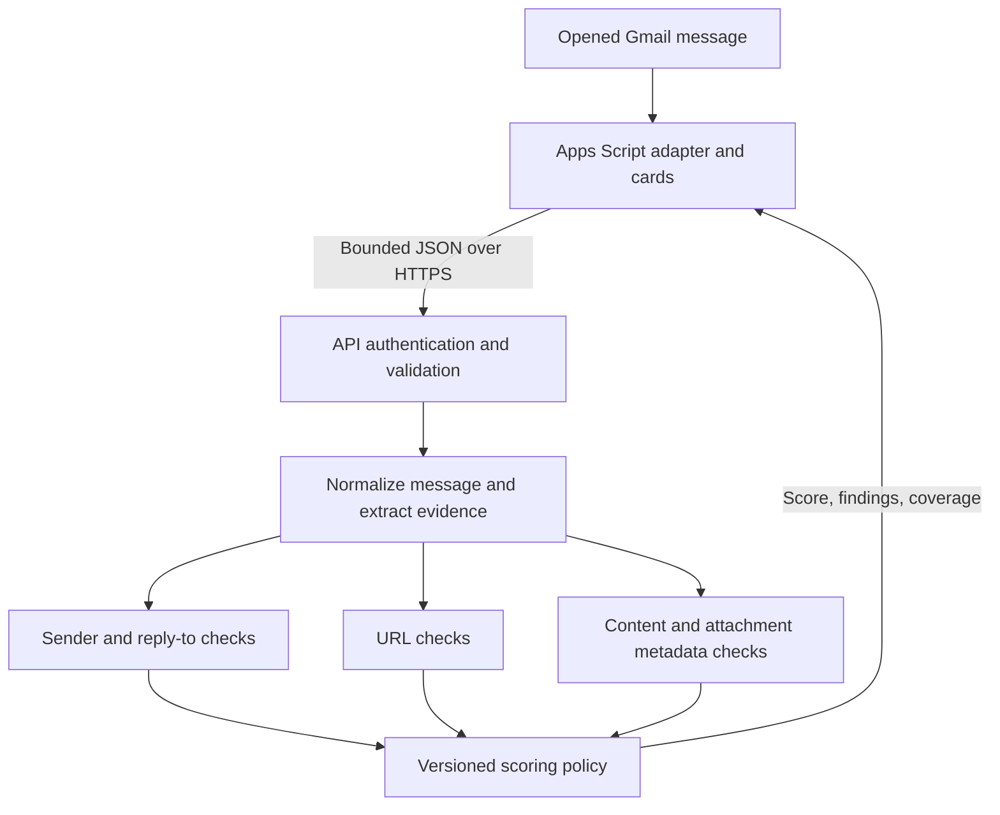

# Upwind Mail Guard

A Gmail add-on that explains why an opened email may be suspicious, backed by a small Python scoring service.

**Archived implementation proposal (2026-11-16).** This document preserves the original design and milestone sequence. For current implemented behavior, setup, and verification, read the root [README](../README.md) and [progress](progress.md). Proposals below are not completion claims.

## Assignment requirements

- A real Gmail add-on built with Google Workspace APIs is the primary product.
- A separate backend communicates with the add-on.
- The UI shows a maliciousness score, a clear verdict, and understandable reasons.
- The solution can be installed in a real Gmail account and demonstrated live.
- The public repository contains all source code and a root README explaining setup, behavior, architecture, decisions, and limitations.

The assignment is intentionally open-ended. A frontend dashboard alone, a command-line scanner alone, or a backend-only demo would not satisfy it.

## Proposed user experience

Open an email, open the add-on sidebar, and choose **Analyze this email**. Explain before the click that bounded message content is sent to the configured backend for analysis. Return:

1. A score from 0 to 100 and a verdict: **Low observed risk**, **Suspicious**, or **High risk**.
2. The strongest reasons, each tied to specific evidence and its score contribution.
3. The suggested next action, such as independently verifying a payment request.
4. Coverage notes: what was checked, missing information, and anything truncated.

A low score means few implemented warning signals were detected, not that the email is safe. Network or parser failures must show **Analysis unavailable**, never a reassuring zero. An incomplete analysis must remain visibly incomplete even if its observed score is low.

## Proposed architecture

Use one backend application with modules, not separate services for each rule.

| Component | Responsibility | Keep out of this component |
| --- | --- | --- |
| Apps Script JavaScript + CardService | Read the selected message, bound the payload, call the API, render escaped results and errors | Scoring policy, mailbox-wide access, secrets in source |
| FastAPI + Pydantic | Authenticate requests, enforce request limits, validate input/output, map errors | Gmail OAuth credentials, email retention |
| Normalization layer | Parse addresses and HTML inertly, extract link text/targets, normalize domains, preserve coverage flags | Fetching links, rendering HTML, executing attachments |
| Pure Python rules | Turn normalized evidence into structured findings | HTTP calls, UI code, hidden state |
| Scoring policy | Deduplicate and cap related findings, calculate the score/verdict, expose policy version | Claims of a calibrated probability |

Use Python because it supports readable parsing and testable analysis and fits the author's existing experience. Plain JavaScript keeps the small Apps Script adapter easy to understand; TypeScript can be added if its complexity becomes worthwhile.

### API contract to establish first

`GET /healthz` reports service availability without exposing configuration.

`POST /v1/analyze` accepts a schema version, selected sender/reply-to fields, subject, bounded plain text and HTML, attachment metadata when available, and extraction/coverage flags. It does not receive a Gmail access token, full mailbox, or attachment bytes. Avoid sending recipient lists or message IDs unless a demonstrated requirement needs them.

The response includes `score`, `verdict`, `analysis_status`, `findings`, `coverage`, and `policy_version`. Each finding includes a stable rule ID, category, severity, bounded evidence, an explanation, and the actual awarded points after deduplication/caps. Distinguish unavailable fields from present-but-empty fields. Validate backend responses in the add-on before displaying them.

Start with a 256 KiB request-body ceiling, bounded field lengths, at most 100 analyzed links and 20 attachment metadata records. These are initial engineering limits to test, not assignment requirements. Enforce the byte ceiling before JSON parsing, including streamed requests without a trustworthy Content-Length header. Truncation must be reported, and important evidence may be missed when truncation occurs.

## Detection and scoring proposal

Begin with a small deterministic rule set:

| Signal | Example | Caveat to explain |
| --- | --- | --- |
| Displayed URL domain differs from destination | Text says `accounts.example.com`, target belongs to `example.net` | Legitimate click tracking also does this; only compare text that actually expresses a URL/domain |
| Deceptive URL structure | User-info before `@`, an IP host, or a misleading trusted-name subdomain | Parse the URL; substring matches are unsafe; IDNs are not inherently malicious |
| From/Reply-To domain mismatch | Replies are directed to a different registrable domain | Help desks and mailing services can do this legitimately |
| Credential/payment request plus pressure | A request to enter a password combined with an urgent deadline | Language heuristics are weak and context-dependent; urgency alone has little weight |
| Risky attachment filename/type metadata | Executable extension or misleading double extension | This is metadata screening, not malware scanning |

Normalize case, Unicode/IDNA, and domain boundaries using a maintained Public Suffix List implementation with a pinned offline snapshot and an explicit update path. Do not use the last two labels as a universal registrable-domain rule. Never fetch the PSL during a scan.

Use a weighted sum with one award per rule/evidence pair, category caps, and a final clamp to 0-100. Initial verdict bands: 0-24 low observed risk, 25-59 suspicious, 60-100 high risk. These thresholds and weights are design hypotheses to refine with fixtures, not measured detection accuracy. Multiple repetitions of the same link must not inflate the score. Show any points suppressed by category/final caps so the displayed score remains auditable.

Keep risk and coverage separate: an email can contain a serious warning even when other checks are unavailable. Do not let an authentication pass cancel a dangerous link finding.

**Defer SPF/DKIM/DMARC scoring until provenance is understood.** Authentication-Results is itself untrusted input outside a verified receiver trust boundary. A matching `authserv-id` string is not sufficient. If Gmail's exposed headers cannot establish trustworthy provenance, report authentication as unverified and award no authentication points. Do not pretend to cryptographically verify DKIM or reconstruct delivery-time SPF from a message alone.

## Security and privacy boundaries

- Prefer the narrow current-message action scope for an explicit Analyze button; prove it supports the required fields in the first live spike. If current-message readonly is needed, document that it also permits open-thread content and still read only the selected message. Do not request broad mailbox read/write scopes by default.
- Gmail authorization stays in Apps Script. Use the temporary event token only there.
- For a single-user demonstration, protect the backend with a high-entropy bearer secret stored in Apps Script Properties and the backend's secret configuration. Compare securely and never log it. Script editors can access project secrets; this is not a multi-tenant identity system. Document rotation.
- Use HTTPS and an explicit backend URL allowlist. Reject redirects for the backend call so the secret cannot follow a redirect to another host. Apply request/time/concurrency limits and authenticated rate limiting; document that in-memory limits are per instance.
- Treat HTML, URLs, filenames, headers, and backend responses as hostile. Parse without network access, escape evidence before CardService formatting, and show suspicious URLs as inert text.
- Do not visit extracted URLs, resolve redirects, load remote images, upload files to scanners, or open attachments. This prevents the scanner from becoming an SSRF/side-effect channel in the initial design.
- Do not persist email content or put it in logs, traces, exception details, fixtures, or screenshots. Log only bounded operational metadata such as latency, status, and rule counts; check hosting defaults too.
- Commit only synthetic fixtures and example configuration. No `.env`, OAuth tokens, service-account keys, clasp credentials, real messages, or private assignment PDF.

## Main decisions and alternatives

| Proposed choice | Benefit | Cost / limitation | Alternative and when to use it |
| --- | --- | --- | --- |
| Apps Script + CardService | Native Gmail surface with little infrastructure | Constrained UI and execution time | HTTP-based Workspace add-on runtime if hosting/integration needs justify more setup |
| Python/FastAPI backend | Clear validation, API schema, isolated testable rules | Two languages across the project | Node/TypeScript for one-language development |
| Deterministic rules first | Explainable, reproducible, fast, no external inference dependency | Misses sophisticated or novel semantic attacks | Add evaluated ML/LLM enrichment only after a baseline; address privacy, prompt injection, latency, and evidence grounding |
| No link fetching or binary scanning | Small attack surface and predictable latency | Cannot inspect redirect destinations, page content, or malicious binaries | Isolated egress-controlled workers with strict budgets when justified |
| Stateless synchronous API | Small operational footprint and simple request trace | No history; caller waits | Queue/workers and storage for genuinely slow analysis |
| No database | No email-retention problem or migration burden | No historical baseline or shared cache | Add storage only for an explicit user/product need |
| Explicit Analyze action | User controls data transmission | One extra click | Automatic analysis after a clearly explained opt-in |
| Shared secret for single-user demo | Simple server-to-server protection | No individual user identity; manual rotation | Verified identity tokens and per-user authorization for broader distribution |
| Container on a managed HTTPS service | Repeatable backend deployment | Hosting setup, possible cold starts and cost | A development HTTPS tunnel for the first spike; do not rely on an untested tunnel for the final demo |

Cloud Run is a reasonable hosting candidate, but the provider is not locked in. First confirm account access, cost, and deployment friction. Localhost alone cannot be reached by Apps Script running on Google's servers.

## Implementation sequence and completion gates

### 0. Prove the integration before building the detector

Create the Apps Script project and Gmail contextual card. Install a test deployment in the demonstration account. Connect it to an authenticated HTTPS backend returning an explicitly marked diagnostic response. Validate the narrow scope, selected-message identity in a multi-message thread, body/header/attachment-metadata availability, URL allowlisting, and timeout behavior.

**Gate:** select an actual email and show a response from the backend inside Gmail. This is an integration experiment, not a usable detector.

### 1. Establish contracts and a pure analysis core

Add validated request/response models, input limits, normalization, stable finding IDs, a versioned scoring policy, and synthetic fixtures. Separate extraction errors from missing evidence. Pin dependencies and the domain-list snapshot.

**Gate:** the same fixture always produces the same findings and score, with exact score accounting.

### 2. Implement the smallest useful signal set

Implement URL deception, sender/reply-to mismatch, contextual request/urgency checks, and attachment metadata checks. Use adversarial and benign look-alike examples while writing each rule. Avoid claiming general phishing detection from a handful of fixtures.

**Gate:** expected findings and false-positive controls pass for each supported rule.

### 3. Complete the Gmail product

Replace the diagnostic response with real analysis. Render score, verdict, evidence, contribution breakdown, coverage, and suggested actions. Include empty-context, denied/expired authorization, partial analysis, malformed response, oversized message, rate-limit, and backend-unavailable states. Escape all untrusted display strings.

**Gate:** both benign and suspicious synthetic emails produce understandable results inside Gmail; switching messages never shows a previous message's result as current.

### 4. Validate security and behavior

Test missing/wrong credentials, oversized/chunked input, malformed HTML and URLs, duplicate links, Unicode and public-suffix edge cases, forged authentication headers, forwarded/quoted content, safe marketing links, error redaction, and absence of unintended network calls. Run API contract tests and focused add-on formatting tests. Add CI for tests and linting.

**Gate:** documented automated checks pass; a separate live Gmail checklist is completed. Report fixture results as limited evidence, not a production accuracy claim.

### 5. Package and rehearse

Provide exact tested local setup, backend deployment, configuration, clasp synchronization, and Gmail test-installation steps. Add sanitized screenshots, example requests/results, test commands, limitations, and a short demo script. Rehearse on the laptop/account used for the interview, including backend failure and recovery.

**Gate:** a fresh checkout can be set up using the README, and the live demo works. Keep a recorded fallback, but the fallback does not replace the required live demo.

### 6. Optional improvements only after the core is complete

Trustworthy authentication evidence if provenance can be established, carefully evaluated reputation checks, additional languages, or independently evaluated semantic analysis. Each addition needs a stated benefit, cost, failure behavior, and security boundary.

## Planned repository layout

| Path | Purpose |
| --- | --- |
| `addon/` | Apps Script manifest, Gmail adapter, API client, card rendering, clasp example config |
| `backend/app/` | FastAPI entrypoint, schemas, normalization, rules, scoring, configuration |
| `backend/tests/` | Rule, boundary, and API contract tests |
| `fixtures/` | Synthetic benign, suspicious, malformed, and ambiguous messages |
| `docs/architecture.md` | Actual component/data-flow design and threat model |
| `docs/decisions.md` | Decisions, alternatives, consequences, and reversal criteria |
| `docs/demo.md` | Live demonstration checklist and failure scenario |
| `docs/progress.md` | Verified implementation status and next step |
| `.github/workflows/` | Lint/test checks, without deployment secrets in source |

These paths are proposed and do not exist yet unless subsequently added. Do not fabricate runnable installation commands before the implementation is validated.

## Interview preparation

For each implemented milestone, be able to trace an email from Gmail through extraction, validation, evidence, scoring, and the rendered card. Explain one concrete input and calculate its score by hand.

For each important choice, answer: What requirement does it serve? What did we give up? What breaks first? What evidence would make us change it?

Practice: Why rules before an LLM? Why is 70 not a 70% probability? Why can SPF pass for a phishing email? How can forwarded mail produce false positives? Why does `trusted.example.attacker.test` belong to the attacker? What prevents SSRF? How is the API authenticated? What happens with missing data, an outage, ten thousand links, or many concurrent users? What would change for a production multi-user service?

## Primary references

- [Gmail add-on surfaces](https://developers.google.com/workspace/add-ons/gmail)
- [Workspace OAuth scopes](https://developers.google.com/workspace/add-ons/concepts/workspace-scopes)
- [Install and test an unpublished add-on](https://developers.google.com/workspace/add-ons/how-tos/testing-workspace-addons)
- [Apps Script quotas and execution limits](https://developers.google.com/apps-script/guides/services/quotas)
- [URL allowlists](https://developers.google.com/apps-script/manifest/allowlist-url)
- [UrlFetchApp request options](https://developers.google.com/apps-script/reference/url-fetch/url-fetch-app)
- [Local Apps Script development with clasp](https://developers.google.com/apps-script/guides/clasp)
- [FastAPI request models](https://fastapi.tiangolo.com/tutorial/body/)
- [RFC 8601: Authentication-Results and trust boundaries](https://datatracker.ietf.org/doc/rfc8601/)
- [Public Suffix List background](https://publicsuffix.org/learn/)
- [Cloud Run overview](https://docs.cloud.google.com/run/docs/overview/what-is-cloud-run)

References checked while planning on 2026-11-16. Recheck relevant platform behavior during the integration spike.
